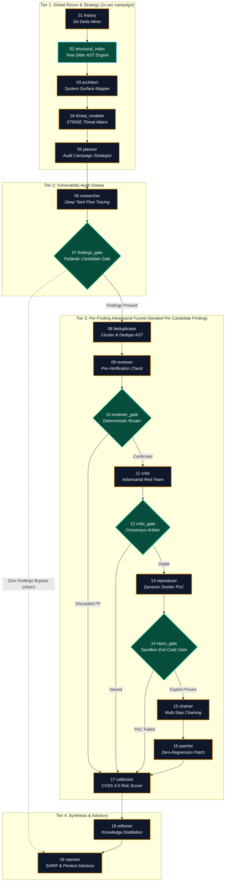

# Google Mantis ADK 2.0: The 19-Node Autonomous Multi-Agent Swarm

This document provides the complete, authoritative specification of the **19-Node Multi-Agent Security Graph** embedded within **NewGenSAST**, derived directly from the Google Mantis ADK 2.0 graph topology (`backend/mantis_engine/workflow.json` and `core/graph_loader.py`).

---

## 1. Graph Architectural Overview

The Mantis pipeline is **not a flat linear conveyor belt**. It operates as a **3-tier hybrid state machine**:
1. **Tier 1 (Global Reconnaissance & Strategy)**: Executed once per campaign scope to map the codebase architecture, AST symbols, and STRIDE matrix.
2. **Tier 2 (Vulnerability Audit Sweep)**: Explores taint flows, sinks, and formulates candidate hypotheses. `07 findings_gate` short-circuits clean campaigns straight to the report ($0 cost).
3. **Tier 3 (Per-Finding Adversarial Verification Funnel)**: Iterates over *each candidate finding independently* through mechanical review, adversarial red-team stress testing, dynamic sandbox exploitation, exploit chaining, automated patch synthesis, and CVSS calibration.
4. **Tier 4 (Distillation & Reporting)**: Distills lessons into repository memory and compiles the final SARIF 2.1.0 & Pentest Advisory Report.

---

## 2. Detailed Specification of the 19 Nodes

### Tier 1: Global Reconnaissance & Surface Strategy

#### Node 01: `history` (History Miner)
* **Type**: LLM Cognitive Agent
* **Squad**: Recon & Surface Mapping
* **Execution Frequency**: 1x per campaign
* **Mission**: Scans repository git logs, commit histories, developer regression patterns, and recent code churn to identify high-risk code regions where security regressions are most probable.
* **Allowed Tools**: `get_git_log`, `get_git_diff`, `read_file`, `write_file`, `list_files`, `get_summary`
* **Default Model**: `gemini/gemini-3.5-flash-lite` (Fast, low-latency reasoning)

#### Node 02: `structural_index` (AST Indexer)
* **Type**: Deterministic Code Engine (Zero-LLM)
* **Squad**: Recon & Surface Mapping
* **Execution Frequency**: 1x per codebase
* **Mission**: Intercepted directly by Mantis ADK (`create_structural_index_node`). Builds a deterministic **Tree-Sitter AST & Symbol Grounding Catalog** on disk. Catalogs function boundaries, symbol definitions, caller-callee hierarchies, and import linkages.
* **Cost**: **$0.00 (0 LLM Tokens, 0 Network Calls)**
* **Powered Tools**: `find_symbol`, `find_callers`, `find_callees`, `get_function_boundary`

#### Node 03: `architect` (System Architect)
* **Type**: LLM Cognitive Agent
* **Squad**: Recon & Surface Mapping
* **Execution Frequency**: 1x per campaign
* **Mission**: Maps external-facing ingress surfaces, trust boundaries, authentication checkpoints, database interaction layers, and microservice dependencies into an authoritative architectural dossier (`workspace/kb/ARCHITECTURE.md`).
* **Allowed Tools**: `read_file`, `write_file`, `list_files`, `record_summary`, `get_summary`

#### Node 04: `threat_modeler` (Threat Modeler)
* **Type**: LLM Cognitive Agent
* **Squad**: Threat Modeling & Strategy
* **Execution Frequency**: 1x per campaign
* **Mission**: Evaluates the architectural surface against the **STRIDE matrix** (Spoofing, Tampering, Repudiation, Information Disclosure, Denial of Service, Elevation of Privilege) and flags sensitive security sinks (e.g. `eval`, SQL queries, OS command execs, deserializers).
* **Allowed Tools**: `read_file`, `write_file`, `list_files`, `get_summary`, `record_threat_model`, `get_threat_model`

#### Node 05: `planner` (Campaign Planner)
* **Type**: LLM Cognitive Agent
* **Squad**: Threat Modeling & Strategy
* **Execution Frequency**: 1x per campaign (with dynamic replanning triggers)
* **Mission**: Translates the STRIDE threat matrix into prioritized, budget-bounded audit hunting plans (`workspace/kb/HUNTING_PLAN.md`). Allocates token budgets across target files.
* **Allowed Tools**: `read_file`, `write_file`, `list_files`, `get_summary`, `get_threat_model`, `record_plan`, `get_plan`

---

### Tier 2: Vulnerability Audit Sweep & Fastpath Gate

#### Node 06: `researcher` (Vulnerability Researcher)
* **Type**: LLM Cognitive Agent
* **Squad**: Deep Vulnerability Audit
* **Execution Frequency**: Sweeps targeted files
* **Mission**: The deep taint-flow investigator. Traces untrusted user inputs to security sinks across function boundaries using SMT constraint reasoning. Emits structured candidate finding hypotheses (`workspace/findings/{id}.json`).
* **Allowed Tools**: `read_file`, `write_file`, `list_files`, `get_summary`, `get_threat_model`, `get_plan`, `report_findings`, `get_findings`, `find_symbol`, `find_callers`, `find_callees`, `get_function_boundary`, `record_regression_check`

#### Node 07: `findings_gate` (Candidate Findings Gate)
* **Type**: Deterministic State-Machine Classifier
* **Squad**: Deep Vulnerability Audit
* **Execution Frequency**: Evaluated after Researcher
* **Mission**: Pure Python router (`create_findings_gate`). Checks the SQLite knowledge base for candidate findings:
  * **If zero findings**: Routes `"clean"` directly to `19 reporter`, immediately halting execution and **skipping all 10 triage/sandbox stages** ($0 compute wasted).
  * **If findings present**: Routes `"__DEFAULT__"` to unlock the Tier 3 Adversarial Funnel.
* **Cost**: **$0.00 (0 Tokens)**

---

### Tier 3: Per-Finding Adversarial Verification Funnel (Iterated Per Candidate)

#### Node 08: `deduplicator` (Finding Deduplicator)
* **Type**: LLM Cognitive Agent
* **Squad**: Adversarial Triage & Falsification
* **Mission**: Clusters overlapping or sibling findings that share the same AST sink or tainted source. Merges duplicates into canonical finding records to eliminate noise.
* **Allowed Tools**: `read_file`, `write_file`, `list_files`, `get_findings`, `report_findings`, `dedupe_findings`

#### Node 09: `reviewer` (Mechanical Pre-Verification Reviewer)
* **Type**: LLM Cognitive Agent
* **Squad**: Adversarial Triage & Falsification
* **Mission**: Performs mechanical pre-verification. Verifies AST call boundaries and inspects sanitizers, type constraints, and framework middleware to detect obvious false-positive indicators.
* **Output Schema**: `ReviewVerdict` (evaluates each finding individually)

#### Node 10: `reviewer_classifier` (Reviewer Routing Gate)
* **Type**: Deterministic State-Machine Classifier
* **Squad**: Adversarial Triage & Falsification
* **Mission**:
  * **`confirmed`**: Routes valid candidate findings to the Adversarial Critic.
  * **`__DEFAULT__` (discarded)**: Bypasses false positives directly to `17 calibrator` without entering expensive sandbox exploitation.
* **Cost**: **$0.00 (0 Tokens)**

#### Node 11: `critic` (Adversarial Red-Team Critic)
* **Type**: LLM Cognitive Agent (Frontier Reasoning Model recommended)
* **Squad**: Adversarial Triage & Falsification
* **Mission**: **The Red-Team Adversary**. Tries to falsify the vulnerability hypothesis. Challenges reachability, network exposure, authentication requirements, and runtime environmental constraints.
* **Output Schema**: `CriticVerdict` (viable vs non-viable)

#### Node 12: `critic_classifier` (Critic Consensus Gate)
* **Type**: Deterministic State-Machine Classifier
* **Squad**: Adversarial Triage & Falsification
* **Mission**:
  * **`viable`**: Passes confirmed, high-confidence exploit hypotheses to dynamic PoC reproduction.
  * **`__DEFAULT__` (vetoed)**: Marks the finding as `non_viable` / `false_positive` and routes to `calibrator`.
* **Cost**: **$0.00 (0 Tokens)**

#### Node 13: `reproducer` (Dynamic Exploit Reproducer)
* **Type**: LLM Cognitive Agent (Frontier Model recommended)
* **Squad**: Exploitation & Remediation
* **Mission**: Synthesizes a standalone, executable Python exploit script (`reproducer.py`). In dynamic sandbox mode (`microsandbox` / `gvisor`), executes the script inside an isolated container (`--network none`) to prove code execution or memory crash.
* **Allowed Tools**: `run_sandbox`, `run_sandbox_with_evidence`, `get_findings`, `get_threat_model`, `read_file`, `write_file`, `get_prior_poc`

#### Node 14: `repro_classifier` (Repro Verdict Gate)
* **Type**: Deterministic State-Machine Classifier
* **Squad**: Exploitation & Remediation
* **Mission**: Inspects the sandbox exit code and evidence logs:
  * **`success` (exit=0 and sink sentinel reached)**: Marks finding as `reproduced` and routes to `chainer` and `patcher`.
  * **`__DEFAULT__` (exploit failed)**: Marks finding as unproven static hypothesis and routes to `calibrator`.
* **Cost**: **$0.00 (0 Tokens)**

#### Node 15: `chainer` (Multi-Step Exploit Chainer)
* **Type**: LLM Cognitive Agent
* **Squad**: Exploitation & Remediation
* **Mission**: Evaluates if the proven vulnerability can be chained with other discovered flaws (e.g. CSRF $\rightarrow$ SSRF $\rightarrow$ RCE) to demonstrate systemic critical impact.
* **Allowed Tools**: `read_file`, `write_file`, `get_findings`, `record_exploit_chain`

#### Node 16: `patcher` (Automated Zero-Regression Patcher)
* **Type**: LLM Cognitive Agent
* **Squad**: Exploitation & Remediation
* **Mission**: Synthesizes minimal, robust, zero-regression security patches (`patch.diff`). In dynamic mode, applies the patch and re-runs the exploit harness to verify that the attack is neutralized without breaking legitimate functionality.
* **Allowed Tools**: `apply_patch`, `run_sandbox`, `query_lineage`, `find_symbol`, `find_callers`, `find_callees`

#### Node 17: `calibrator` (Risk & CVSS 4.0 Calibrator)
* **Type**: Deterministic / Structured LLM Evaluator
* **Squad**: Exploitation & Remediation
* **Mission**: Calculates the final Mantis Risk Score, priority (`CRITICAL`, `HIGH`, `MEDIUM`, `LOW`), inferred exposure, and CVSS 4.0 vector based on proof of exploitability and production blast radius.
* **Output Schema**: `FindingCalibration`

---

### Tier 4: Global Distillation & Pentest Advisory Reporting

#### Node 18: `reflector` (Meta-Learner & Distillation)
* **Type**: LLM Cognitive Agent
* **Squad**: Exploitation & Remediation
* **Execution Frequency**: 1x per scan
* **Mission**: Reviews the entire campaign execution history. Distills recurring architectural anti-patterns, framework nuances, and model learning notes into the repository's permanent memory (`knowledge.db`).
* **Allowed Tools**: `read_file`, `write_file`, `get_findings`, `record_learning`

#### Node 19: `reporter` (Pentest Advisory & SARIF Reporter)
* **Type**: LLM Cognitive Agent
* **Squad**: Exploitation & Remediation
* **Execution Frequency**: 1x per scan
* **Mission**: Compiles the final consolidated security deliverable:
  * **Executive Summary**: Overview of discovered vs falsified vulnerabilities.
  * **Pentest Advisory Report**: Full vulnerability breakdowns with reproduction steps, PoC scripts, and mitigation guidance.
  * **SARIF 2.1.0 Export**: Industry-standard Static Analysis Results Interchange Format for GitHub Code Scanning, GitLab Security, and DefectDojo.
* **Allowed Tools**: `read_file`, `write_file`, `get_findings`, `get_plan`, `get_threat_model`, `get_summary`, `generate_report`
